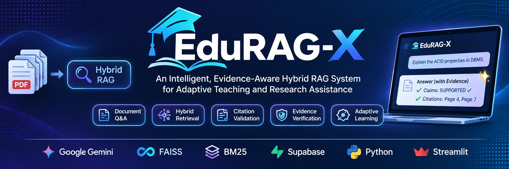
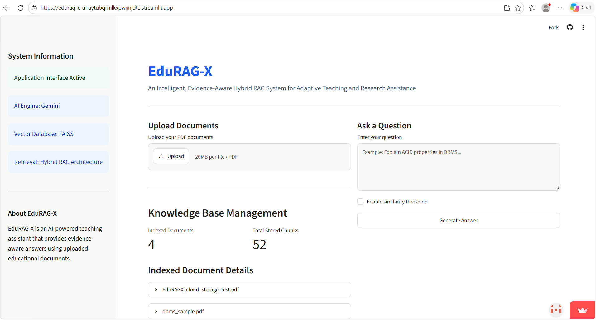

<p align="center">
  
</p>
<p align="center">
  <a href="https://edurag-x-unaytubqrmlkxpwijnjdte.streamlit.app/">
    
  </a>
  <a href="https://github.com/MohitYadav1430/EduRAG-X">
    
  </a>
</p>
# EduRAG-X

### An Intelligent, Evidence-Aware Hybrid RAG System for Adaptive Teaching and Research Assistance

EduRAG-X is a document-grounded AI teaching assistant that combines semantic search, keyword retrieval, evidence filtering, citation validation, and claim-level evidence verification to provide more reliable answers from uploaded PDF documents.

## Application Preview

<p align="center">
  
</p>

## About EduRAG-X

EduRAG-X is an AI-powered teaching and research assistant designed to make document-based learning more reliable through hybrid retrieval and evidence verification.

Unlike a basic document chatbot, EduRAG-X combines semantic search, keyword retrieval, citation validation, and claim-level evidence verification to improve answer traceability.

The system also supports general AI conversations beyond uploaded documents.

## Key Features

- **PDF Ingestion:** Extract text and metadata from uploaded PDF documents.
- **Text Chunking:** Fixed-size and experimental sentence-aware chunking.
- **Semantic Retrieval:** Vector-based document retrieval using FAISS.
- **Keyword Retrieval:** BM25-based keyword search.
- **Hybrid Retrieval:** Combines semantic and keyword results using Reciprocal Rank Fusion (RRF).
- **Evidence Filtering:** Filters retrieved content based on relevance scores.
- **Citation Validation:** Checks source and page references.
- **Evidence Verification:** Uses Gemini to classify answer claims as SUPPORTED, UNSUPPORTED, or UNCERTAIN.
- **General AI Assistant:** Supports general questions and different learning modes.
- **Processing History:** Tracks document ingestion status.

## Built With

<p align="center">
  
  
  
  
  
</p>

## Technology Stack

| Component | Technology |
|---|---|
| Programming Language | Python |
| User Interface | Streamlit |
| LLM | Google Gemini API |
| Embedding Model | gemini-embedding-2 |
| Generation Model | gemini-3.6-flash |
| Vector Database | FAISS |
| Keyword Retrieval | BM25 |
| PDF Processing | PyMuPDF |
| Numerical Computing | NumPy |
| Testing | Pytest |

## Architecture

1. User uploads PDF documents.
2. PyMuPDF extracts document text.
3. TextChunker divides text into manageable chunks.
4. Gemini generates document embeddings.
5. FAISS stores and indexes document vectors.
6. Semantic and BM25 retrievers independently retrieve relevant chunks.
7. HybridRetriever combines results using RRF.
8. Evidence relevance filtering selects relevant chunks.
9. Gemini generates an evidence-grounded answer.
10. Citation validation and evidence verification evaluate the generated response.

For a detailed system architecture, see
[Architecture Documentation](docs/architecture.md).

## Project Structure

```text
EduRAG-X/
│
├── app.py
├── requirements.txt
├── pytest.ini
├── .env.example
│
├── src/
│   └── edurag_x/
│       ├── config/
│       ├── ingestion/
│       ├── learner/
│       ├── llm/
│       ├── rag/
│       └── research/
│
├── tests/
├── scripts/
├── docs/
└── data/
    └── sample_documents/
```

## Installation

Clone the repository:

```bash
git clone <YOUR_GITHUB_REPOSITORY_URL>
cd EduRAG-X
```

Create a virtual environment:

```bash
python -m venv venv
```

Activate it on Windows:

```powershell
.\venv\Scripts\Activate.ps1
```

Install dependencies:

```bash
pip install -r requirements.txt
```

## Environment Configuration

Create a `.env` file in the project root:

```env
GEMINI_API_KEY=your_gemini_api_key
```

Never upload your actual API key or `.env` file to GitHub.

## Run the Application

```bash
streamlit run app.py
```

## Testing

Run the complete test suite:

```bash
python -m pytest -v
```

Current test status:

- Total tests: 128
- Passed: 128
- Failed: 0

## Preliminary Evaluation

The initial retrieval experiments use two synthetic DBMS PDF documents, eight chunks, and five manually prepared queries.

The preliminary hybrid retrieval experiment reported:

| Metric | Semantic | BM25 | Hybrid |
|---|---:|---:|---:|
| Precision@3 | 0.4167 | 0.3333 | 0.4167 |
| Recall@3 | 1.0000 | 0.8750 | 1.0000 |
| MRR | 0.8750 | 0.8750 | 0.8750 |

These results are preliminary and limited to a small synthetic dataset. They do not establish general performance improvements over individual retrieval methods.

Detailed experimental records are available in the `docs/` directory.

## Development Status

**Implemented:**
- PDF ingestion and processing
- Text chunking
- Gemini embeddings
- FAISS vector storage
- Semantic retrieval
- BM25 keyword retrieval
- Hybrid retrieval using RRF
- Evidence relevance filtering
- Citation validation
- Evidence verification
- Streamlit interface
- Processing history
- Automated tests

**Planned / Under Development:**
- Advanced research paper intelligence
- Learner knowledge modeling
- Misconception detection
- Adaptive learning recommendations
- Larger-scale evaluation and benchmarking

## Current Limitations

- Retrieval evaluation is currently based on a small synthetic dataset.
- Evidence verification depends on Gemini model judgments.
- Citation validation checks source and page references, not complete semantic correctness.
- Large-scale evaluation and multi-user testing are still pending.

## Future Scope

- Improve retrieval quality through larger datasets.
- Evaluate different chunking strategies.
- Develop adaptive learning capabilities.
- Improve evidence verification reliability.
- Conduct reproducible experiments.
- Prepare the system for research publication.

## Security

- Keep API keys private.
- Do not upload personal or confidential documents.
- Keep environment variables and runtime data out of version control.

---

**EduRAG-X** — Building a more evidence-aware and adaptive AI learning assistant.