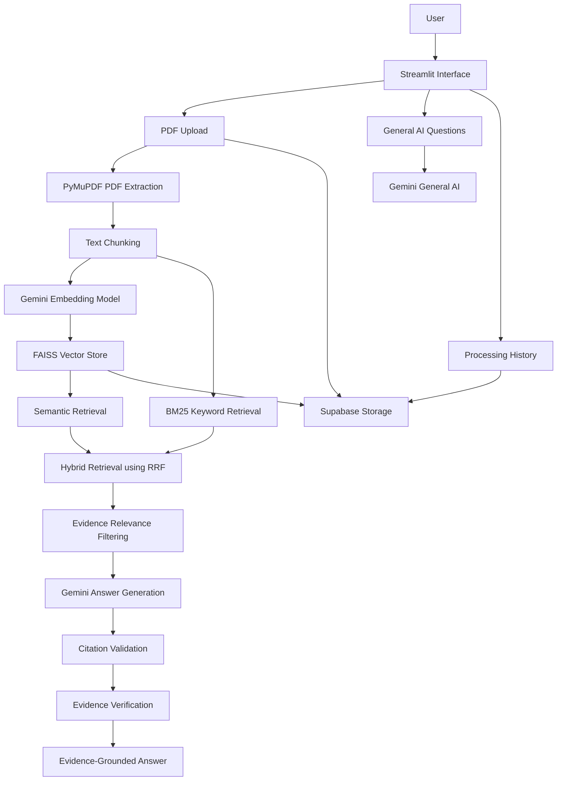

# EduRAG-X System Architecture

EduRAG-X follows a hybrid Retrieval-Augmented Generation (RAG) architecture with evidence validation and persistent cloud storage.

## Main Components

1. **Document Ingestion:** Extracts text from uploaded PDF files.
2. **Text Chunking:** Divides extracted content into smaller chunks.
3. **Embedding Generation:** Uses Gemini embeddings.
4. **Hybrid Retrieval:** Combines semantic and BM25 retrieval using Reciprocal Rank Fusion.
5. **Answer Generation:** Generates answers using Gemini.
6. **Evidence Validation:** Performs citation validation and claim-level evidence verification.
7. **Persistent Storage:** Uses Supabase Storage for documents, vector indexes and processing history.
8. **General AI:** Supports general questions beyond uploaded documents.